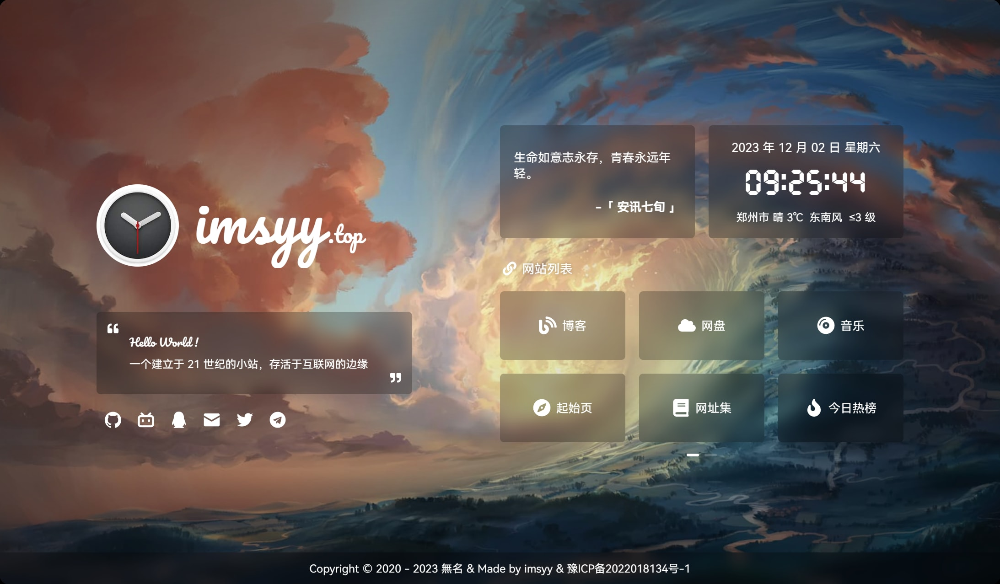

# openroute.qzz.io · 个人主页

自托管小站 [openroute.qzz.io](https://openroute.qzz.io) 的首页 —— 一个聚合全部自托管服务的导航门户，带一言、实时时钟、时光进度条与实时天气。

基于 [imsyy/home](https://github.com/imsyy/home)（MIT）定制，致谢原作者。



## ✨ 特性

- **服务导航** —— 一屏聚合所有自托管服务入口
- **实时天气** —— 小米天气 API，经同源 `/wtr` 反代（见下）
- **一言 / 时钟 / 时光进度条** —— Hitokoto、DSEG 段码时钟、年度进度
- **纯静态 SPA** —— Vue3 + Vite 构建，产物直接丢 Nginx，无后端无数据库
- **PWA + 移动端适配**

## 🧩 已收录服务

| 服务 | 说明 |
|------|------|
| IT-Tools | 开发者工具箱 |
| BentoPDF | 客户端 PDF 工具箱 |
| MicroBin | 文件/文本中转 |
| 健身动作库 | 1324 个动作浏览 |
| 购房指北 | 房价趋势可视化 |
| A股智能分析 | 定时分析 WebUI |
| RetroAssembly | 浏览器复古游戏机 |

## ⚙️ 配置

改这几处即可，无需动组件代码：

- `.env` —— 站点名、作者、简介、建站日期、**天气坐标**（`VITE_WEATHER_LON` / `VITE_WEATHER_LAT`）
- `src/assets/siteLinks.json` —— 服务导航卡片（名称 / 图标 / 链接）
- `src/assets/socialLinks.json` —— 社交链接
- 图标从 `@vicons/fa` 导入，在 `src/components/Links.vue` 里映射

## 🌦️ 天气代理（小米 API）

小米天气接口跨域且需 `User-Agent` 头，浏览器不能直连。生产环境走服务器 Nginx 同源反代 `/wtr` → `https://weatherapi.market.xiaomi.com/wtr-v3/`：

```nginx
location /wtr/ {
    proxy_pass https://weatherapi.market.xiaomi.com/wtr-v3/;
    proxy_ssl_server_name on;
    proxy_set_header Host weatherapi.market.xiaomi.com;
    proxy_set_header User-Agent "Mozilla/5.0 (Windows NT 10.0; Win64; x64) AppleWebKit/537.0";
    proxy_set_header Referer "";
}
```

本地开发/预览时，`vite.config.js` 里已内置 `server.proxy` / `preview.proxy` 的 `/wtr` 转发，无需额外配置。

> 参考 imsyy/home issue [#416](https://github.com/imsyy/home/issues/416)。原高德/教书先生天气接口已失效，故换小米。

## 🚀 构建 & 部署

```bash
# 依赖
npm install -g pnpm
pnpm install

# 本地预览（含 /wtr 代理，天气可用）
pnpm dev

# 构建
pnpm build            # 产物在 dist/

# 部署：把 dist/ 内容放到 Nginx 站点根目录
#   root /usr/share/nginx/html;
#   try_files $uri $uri/ /index.html;
```

> Node > 16.16，pnpm 已锁在 `packageManager` 字段。
> 因启用 PWA Service Worker，更新后浏览器端可能需 `Ctrl` + `F5` 强刷。

## 📄 License

[MIT](./LICENSE) · 基于 [imsyy/home](https://github.com/imsyy/home) 定制
